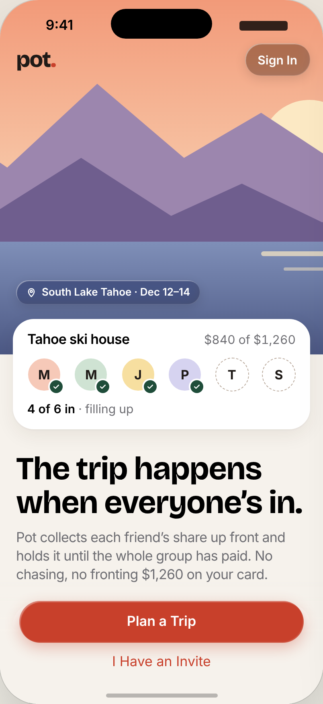
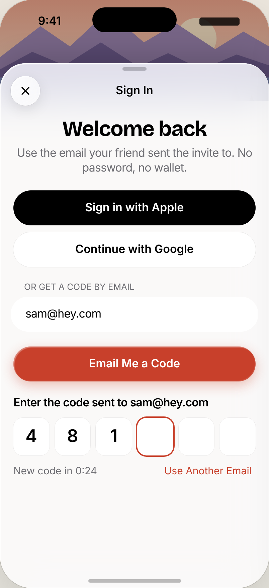
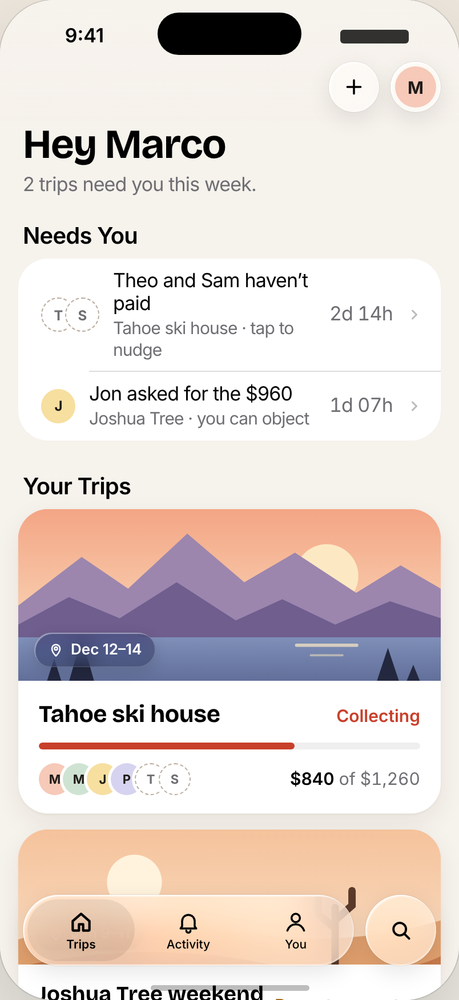
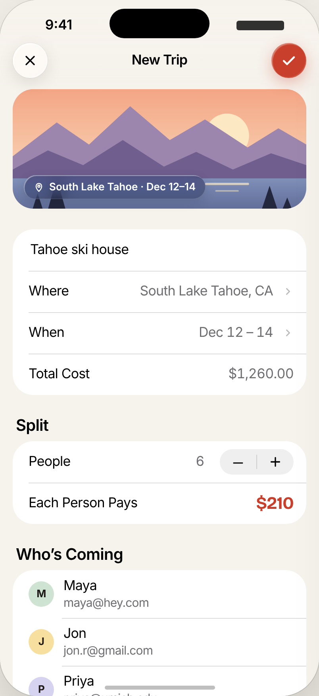
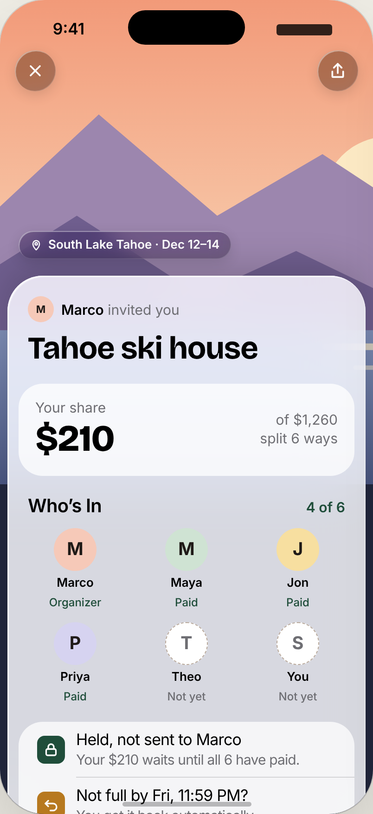
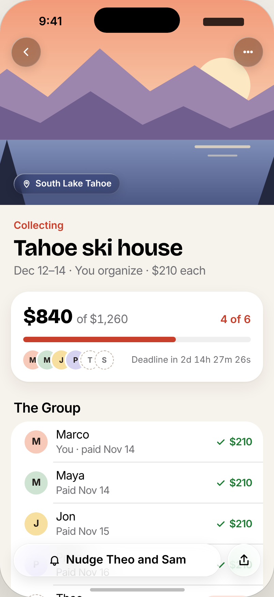
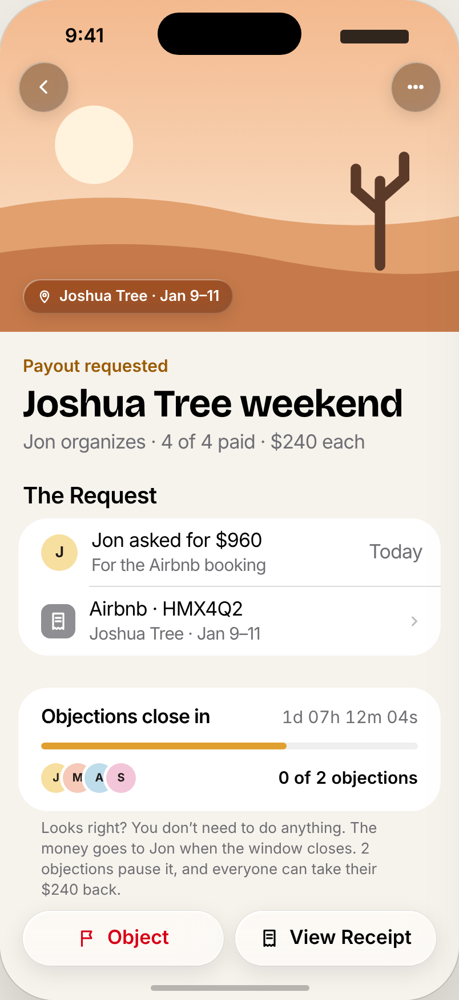
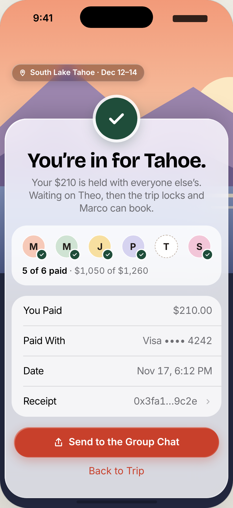
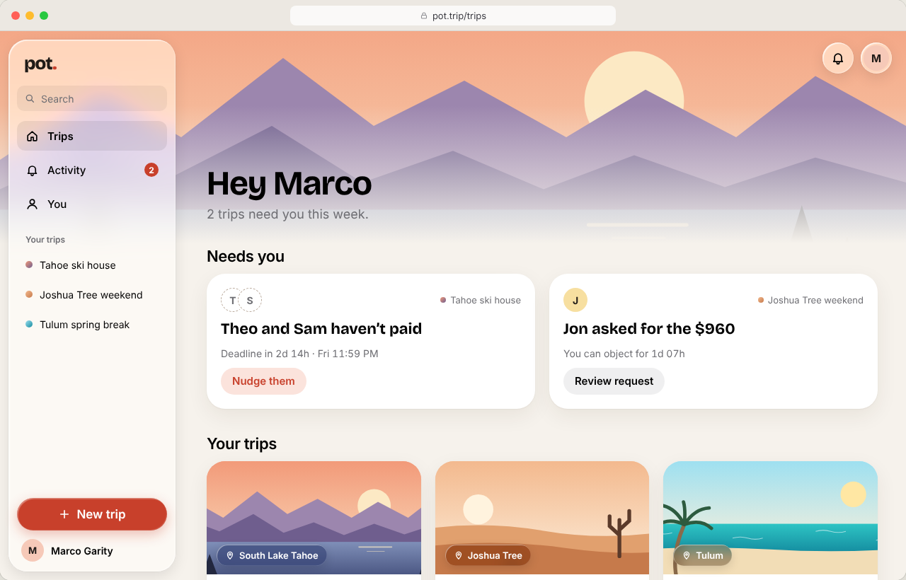

# Pot design: Trip-first Glass (direction I)

Status: **proposed**. This does not replace `web/DESIGN.md` (Pot Grid) yet. Making it canonical is a separate decision.

Live mockups (Claude canvas): https://claude.ai/artifact/RPBQvjcMZJcA5gq18awHkc
Pages: **I · Trip-first Glass** (iPhone, primary) and **I · Web (Trip-first Glass)** (desktop).

## The idea in one paragraph

The trip is the object, not the money. Every trip has a postcard cover and a row of friends' faces that fill in as people pay. That content runs full-bleed, and everything you tap sits on top of it as iOS 26 Liquid Glass: a floating tab bar, glass nav buttons and toolbars, and glass sheets for joining, signing in and paying. Money is shown in dollars. Crypto only appears in a Details row ("Held in USDC on Arc").

## Product and demo decisions

- **One product: the web app** in `web/`. No native iOS build.
- **The demo runs on an iPhone** as a home-screen web app (Safari > Share > Add to Home Screen, full screen, no browser bars). Needs a web app manifest with `display: standalone` and icons.
- **Build phone-first.** Every screen is designed at iPhone width (390 to 430px) first. Desktop is a widened version and second priority.
- **Two-screen demo:** the phone runs Sam's story (open invite, join, pay $210); a laptop browser shows Marco's dashboard updating and the pot locking.
- **Pitch line:** a web app that installs from a link. Friends pay from the invite link without downloading anything.

## iPhone screens (primary)

| # | Screen | Repo files today |
|---|---|---|
| I1 | Signed-out home | `web/app/(screens)/page.tsx` |
| I2 | Sign in (sheet) | `web/components/pot/SignInForm.tsx`, `OAuthButtons.tsx` |
| I3 | Dashboard | `web/components/pot/DashboardView.tsx`, `DashboardParts.tsx`, `PotList.tsx` |
| I4 | Start a pot (sheet) | `web/components/pot/CreatePotForm.tsx` |
| I5 | Join invite | `web/components/pot/JoinPreview.tsx` |
| I6 | Pot page: Collecting | `PotPageView.tsx`, `PotLifecycle.tsx`, `MemberList.tsx`, `InviteLink.tsx`, `potState.ts` |
| I7 | Pot page: Payout requested | same as I6 plus `PotActions.tsx` |
| I8 | Paid confirmation | `web/components/pot/PotActions.tsx` |

<p>
   
</p>
<p>
   
</p>

## Desktop screens (secondary)

W1 home, W2 sign in, W3 dashboard (glass sidebar over the trip art), W4 start a pot, W5 join, W6 collecting, W7 payout requested, W8 paid. W9 is the cover generation spec (a design file only, never shown in the app).



All in `screens/web/`.

## Tokens

Full values in [`tokens.json`](tokens.json). The short version:

- **Background** warm `#F6F2EC`, white grouped cells, 26px radius groups and cards, 38px sheets.
- **Coral `#C8402B` is only for the one main action per screen** (white text, 4.97:1). Never on tabs, toolbars or decoration.
- **Tab bar and toolbars stay black and white**, because the trip art is already colorful.
- **Faces:** six pastel fills with ink initials. Unpaid friends are white with a dashed `#B9A99B` border. Paid friends get a small pine check badge.
- **Type:** Bricolage Grotesque 700/800 for big titles only (screen titles, trip names, the share amount). System font (SF Pro on iPhone) for everything else, at iOS text sizes (34 / 22 / 17 / 15 / 13).

## Glass rules (from Apple's HIG, via dickwu/apple-design-skill)

1. Glass only on things you tap that float above content: tab bar, nav buttons, toolbars, sheets. **Never on cards, list rows or backgrounds.**
2. **Controls on top of the art** use the dark clear glass (`glass.clearOnArt`, a 35% dim) so white labels stay readable on a bright sky.
3. **Sheets** use the more opaque `glass.sheet` because they hold text.
4. **One prominent (coral) button per screen,** on the trailing side of a toolbar.
5. Scroll edge: a fade from the background color behind the top nav, not a solid bar.
6. 44px minimum touch targets.
7. **On the web the glass is CSS:** `backdrop-filter` plus the `-webkit-` prefix. Keep it to these few surfaces, because blur over scrolling images is expensive on mobile Safari. Test scrolling on a real iPhone early. `prefers-reduced-transparency` only works in Chromium, so also offer a solid fallback where `backdrop-filter` isn't supported (`@supports not (backdrop-filter: blur(1px))`).

## Trip covers (generated, never advertised)

Every trip gets a cover from its destination and dates. **The app never mentions this:** no toggle, no "generated" badge, no theme name, no settings. The cover is simply there when the trip is created.

Reference implementation: [`cover-scenes.ts`](cover-scenes.ts) (no dependencies, type-checked with `tsc --strict`).

- `pickTheme({ placeType, month, hemisphere })` maps the geocoder's place category plus the start month to one of 9 looks across 6 drawn scenes (lake, snow, desert, beach, city, event). Tahoe in December is "Alpine dusk"; Lake Como in July is "Riviera summer": same lake scene, different palette.
- `coverSvg(key, tripId)` returns the SVG string. It works as a hero, a card cover and a thumbnail (`preserveAspectRatio="xMidYMid slice"`).
- `THEMES[key].tint` is a very light background tint for that trip's page.
- **Unknown place:** use the default look (Alpine dusk). Note: this differs from the W9 board, which also guessed from the season alone. I dropped that because it guesses wrong (snow for Miami in January).
- Covers are drawn scenes, not photos or AI images: they look consistent, cost nothing to make, and load instantly.

## Known gaps to resolve before the demo

- **The card payment shown on the paid screens isn't real.** The mockups show "Paid with Visa •••• 4242", but Pot only takes test USDC today. Either add a card-to-USDC step or change that row before judges see it.
- **These screenshots were rendered on Linux.** Inter stands in for SF Pro; on an iPhone the system font is SF Pro.
- **The demo data is illustrative:** Tahoe ski house, $1,260 split 6 ways, members Marco, Maya, Jon, Priya, Theo and Sam.

## Files

```
docs/design/trip-first-glass/
  README.md          this file
  tokens.json        colors, type, radii, glass recipes
  cover-scenes.ts    trip cover generator (reference implementation)
  screens/ios/       I1 to I8 at 2x
  screens/web/       W1 to W9 at 1x (1280x820 browser windows)
```
